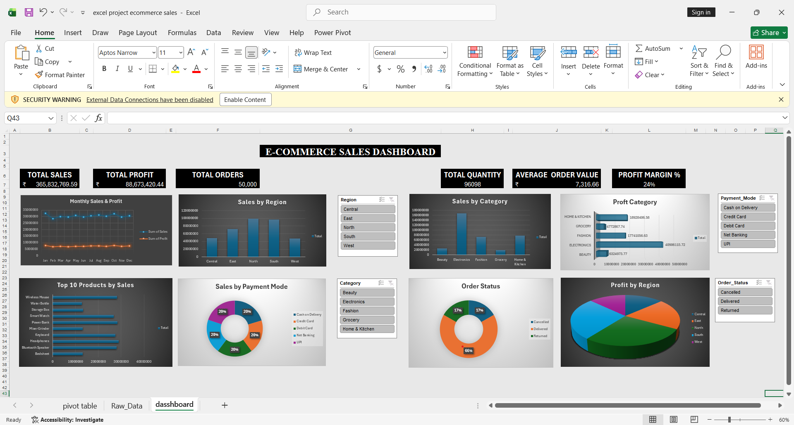

# Excel E-Commerce Sales Dashboard

## Project Overview
This project focuses on analyzing E-Commerce sales data using Microsoft Excel. An interactive dashboard was created to track sales performance and generate useful business insights.

## Tools Used
- Microsoft Excel
- Power Query
- Pivot Tables
- Charts
- Slicers

## Key Features
- Interactive sales dashboard
- KPI tracking
- Sales performance analysis
- Pivot Table analysis
- Interactive slicers and charts

## Dashboard Preview

## Project File
- `excel project ecommerce sales.xlsx`

## Author
Vedant Sandeep Pandhare

Aspiring Data Analyst | Python | SQL | Power BI | Excel# Excel-Dashboard-Project
Excel Dashboard using Pivot Tables, Charts and Slicers
